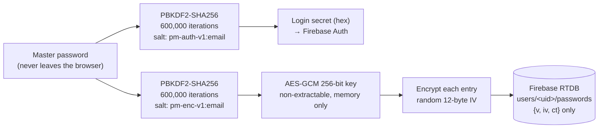

# 🔐 VaultX — Zero-Knowledge Password Manager

A browser-based password manager where **the server never sees your passwords or your master password**.
Every entry is encrypted in the browser with AES-GCM before it is synced to Firebase.

**Live:** https://password-manager-beta-one.vercel.app/

---

## How the encryption works



- **Two independent derivations.** The master password is stretched twice with different salts:
  one result logs in to Firebase Auth, the other becomes the encryption key. Firebase only ever
  sees the login secret, which reveals nothing about the key.
- **600,000 PBKDF2 iterations** (OWASP 2023 guidance for PBKDF2-HMAC-SHA256).
- **AES-GCM with a fresh random IV per entry**, so tampered ciphertext fails to decrypt instead of
  returning garbage.
- **Non-extractable key** (`crypto.subtle.importKey(..., false, ...)`) that lives only in memory.
  Nothing sensitive is written to `localStorage`, and the Firebase session is not persisted, so a
  reload always returns to the lock screen.

## Security features

| Feature | Detail |
|---|---|
| Zero-knowledge storage | Database holds only `{v, iv, ct, createdAt}` per entry |
| Per-user database rules | `database.rules.json`: users can only read/write `users/<their uid>`; every field is type- and size-validated, unknown fields rejected |
| Auto-lock | Vault locks and the key is dropped after 5 minutes of inactivity |
| Clipboard auto-clear | Copied passwords are wiped from the clipboard after 30 seconds |
| Unbiased password generator | `crypto.getRandomValues` with rejection sampling (no modulo bias) |
| Strength meter | Live feedback while typing; master password minimum 12 characters |
| Security headers | `vercel.json` sets CSP, HSTS, `frame-ancestors 'none'`, `nosniff`, `no-referrer` |
| Legacy migration | Old plaintext local entries are encrypted, uploaded, then deleted |

> The Firebase web config in `app.js` is public by design. Access is enforced by Firebase Auth and
> the database rules, not by hiding the API key.

## Threat model

**Protects against:** a database leak or a curious server operator (only ciphertext is stored),
another user reading your vault (database rules), someone using your unlocked laptop later (auto-lock),
and passwords lingering in the clipboard.

**Does not protect against:** malware or a malicious extension on your own device, a weak master
password, or a compromised CDN script.

## Known limitations / next steps

- The salt is derived from the email address. A random per-user salt stored with the account would
  be stronger against precomputation.
- No master-password recovery. That is the price of zero-knowledge: forget it and the vault is gone.
- Third-party scripts load from CDNs without Subresource Integrity hashes. Adding SRI (or
  self-hosting them) would close that gap.
- Possible upgrade: Argon2id (memory-hard) via WebAssembly instead of PBKDF2.

## Tech stack

HTML, CSS, vanilla JavaScript, Web Crypto API, Firebase Auth, Firebase Realtime Database, Vercel.

## Run locally

```bash
git clone https://github.com/VivekSharma0502/password-manager.git
cd password-manager
npx serve .        # or any static server, then open the printed URL
```

To use your own backend, create a Firebase project, enable Email/Password auth and Realtime Database,
paste your config into `app.js`, and deploy `database.rules.json`.
